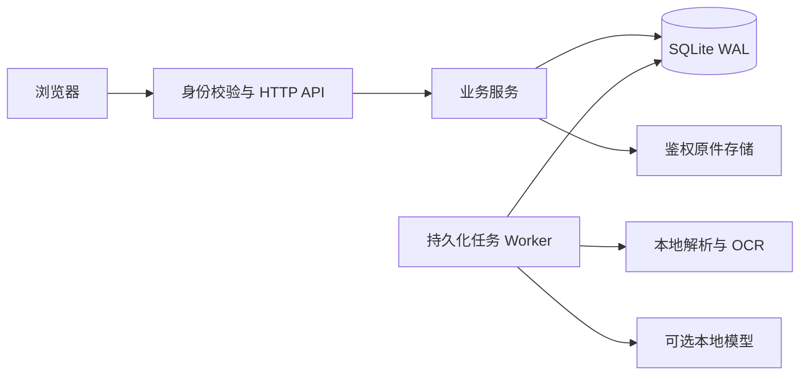

# Talent Hub · HR 人才库平台

[](https://github.com/MaYangle/hr-talent-platform/actions/workflows/quality.yml)
[MIT License](LICENSE) · [快速开始](#快速开始) · [使用手册](docs/USAGE.md) · [配置参考](docs/CONFIGURATION.md) · [贡献指南](CONTRIBUTING.md)

面向 HR 和招聘团队的自托管人才工作区：集中管理简历和人才档案，按岗位分配跟进责任，用可回溯证据辅助匹配，并连接面试反馈和招聘运营分析。

应用使用 Python、SQLite 和原生浏览器界面，无需前端构建。首次启动创建自己的管理员账号，进入空白工作区；仓库不附带候选人数据、模拟简历、默认密码或预置岗位。

当前为 **0.1.0 早期公开版本**，适合单组织、单实例的内部工作区。采用 SQLite WAL 和进程内 Worker；尚不提供高可用、多组织隔离、SSO 或 PostgreSQL。面向公司部署时，应结合实际访问量和数据政策完成部署验收。

## 核心能力

| 业务环节 | 提供的能力                                                             |
| -------- | ---------------------------------------------------------------------- |
| 简历入库 | PDF、DOCX、UTF-8 TXT，本地 OCR、后台解析、字段核对、重复对照、失败恢复 |
| 人才档案 | 分组资料、完整度与人工核实、简历原文窗口、版本切换、全屏阅读及原件下载 |
| 搜索队列 | 状态多选、关键词与组合筛选、日期区间、排序分页及人才 CSV 导出          |
| 岗位跟进 | 不可变 JD 版本、各岗位独立阶段、负责人、下一步动作与期限               |
| 面试协作 | 轮次与安排、时间冲突检查、统一反馈、应用内逾期提醒                     |
| 决策辅助 | 证据规则或本地模型、硬性条件、覆盖度、原文证据、固定输入快照           |
| 运营复盘 | 阶段转化、停留时间、渠道质量、逾期事项、关联人才查询及授权导出         |
| 团队运维 | 四类角色、服务端权限、审计、完整备份与恢复、健康检查、工作区独占锁     |

匹配用于整理 HR 复核队列，不自动联系、录用或淘汰候选人。原件、提取、OCR 和模型处理默认留在本机服务环境；模型不可用时不会自动调用云端服务。

日常操作集中在人才库、简历导入、招聘、系统设置四个入口。启用本地模型后，简历提取原文后会自动按字段填表并附原文位置，再由 HR 核对；模型不可用时保留规则结果和原件，可重新提取。没有原文依据的信息不会自动补造。

招聘模块包含岗位、匹配、跟进、面试和统计标签。统计查询进入人才库后会显示查询原因、岗位、渠道、入库日期范围与统计时点，可返回原统计范围或查看全部人才。招聘阶段与人才库状态分别管理。

PDF 原文按原始页面渲染；DOCX 阅读预览保留正文、表格、基本格式和内嵌图片，但不保证与 Word 排版完全一致，精确排版请打开或下载原件。未上传附件的档案显示已录入正文。原件预览沿用服务端访问权限与审计，不上传到第三方预览平台。

## 技术栈

- Python 3.12 标准库 HTTP 服务、SQLite WAL 事务存储和进程内持久化任务 Worker。
- 原生 JavaScript ES Modules、HTML、CSS，无前端编译或运行时框架依赖。
- pypdf、pypdfium2、python-docx、Pillow 处理文档；可选 Windows OCR / Tesseract 与 OpenAI 兼容模型端点。
- unittest、Playwright（真实浏览器）、Ruff、Prettier 提供回归和质量检查。

## 典型用法

1. 管理员首次创建工作区，建立 HR、招聘经理和面试官账号，按需在系统设置配置模型及 API Key。
2. HR 导入获得授权的简历，核对提取字段并人工核实档案；在“简历原文”中阅读附件、切换版本。
3. 进入招聘工作流，在岗位标签建立 JD 和条件，在匹配标签生成固定输入、可回溯的结果。
4. 将合适人才加入岗位流程，在跟进标签明确负责人、下一步和期限，直接安排关联面试。
5. 面试官提交反馈，HR 再人工推进岗位阶段；在统计中复盘，按权限导出 CSV 或 JSON。

## 快速开始

### 依赖要求

- **Python 3.12**：当前 CI 使用该版本；直接及间接 Python 依赖固定在 [requirements.txt](requirements.txt)。
- 现代 Chrome、Edge 或 Firefox 浏览器。
- 首次安装依赖需要访问 Python 包源；可另行准备离线 wheel 包。
- OCR 为可选能力：Windows 需要系统 OCR 语言包；Linux 需要 Tesseract 及语言数据。
- **Node.js 22+ 仅用于开发检查和浏览器测试**，运行应用无需 Node.js。

### Windows

```powershell
git clone https://github.com/MaYangle/hr-talent-platform.git
cd hr-talent-platform
python -m venv .venv
.venv\Scripts\python.exe -m pip install -r requirements.txt
.venv\Scripts\python.exe server.py
```

也可以双击根目录的 `start_windows.cmd`，首次会创建虚拟环境、安装依赖并打开浏览器；`stop_windows.cmd` 用于停止该目录启动的后台服务。

### Linux

```bash
git clone https://github.com/MaYangle/hr-talent-platform.git
cd hr-talent-platform
python3.12 -m venv .venv
.venv/bin/python -m pip install -r requirements.txt
.venv/bin/python server.py
```

访问 **http://127.0.0.1:4173**，在服务所在电脑上创建管理员，然后建立团队账号、导入获得授权的简历并核对字段。业务流程见[使用手册](docs/USAGE.md)。

macOS 的基础服务遵循同样的 Python 启动方式，但当前 CI 不包含 macOS，且没有内置 macOS OCR 适配器；扫描件可先转换成带文本层的 PDF。

### Docker

```bash
docker compose up --build -d
docker compose ps
```

默认只映射本机 4173，数据保存在 `talent-data` 具名卷；镜像包含中文和英文 Tesseract OCR。容器配置、模型网络限制、HTTPS 与备份见[部署与运维](docs/OPERATIONS.md)。

## 配置与数据

基础功能不需要 API Key。可通过环境变量调整启动配置，例如 PowerShell：

```powershell
$env:TALENT_DATA_DIR = 'D:\TalentHubData'
$env:TALENT_PORT = '4180'
.venv\Scripts\python.exe server.py
```

Python 入口不会自动加载 `.env`。[.env.example](.env.example) 提供无凭据的配置清单；变量、范围和 Docker 用法见[配置参考](docs/CONFIGURATION.md)。

默认数据目录为 Windows 的 `%LOCALAPPDATA%/TalentHub/workspace-v2`，其他系统为 `~/TalentHub/workspace-v2`。数据库、原件和审计存放在该服务端目录，浏览器刷新不会删除团队资料。同一个数据目录只允许一个应用实例，防止重复 Worker 改写任务状态。

新工作区默认用 `Qwen/Qwen3.8-27B`（`http://172.30.0.101:20001/v1`）辅助简历字段提取，岗位匹配仍默认使用证据规则；模型调用失败会保留规则结果供核对。模型接口仅允许回环地址或上述精确内网端点。管理员可在网页系统设置保存并测试 API Key，也可用 `TALENT_MODEL_API_KEY` 环境变量提供 Bearer 密钥；网页不会回显已保存密钥。模型、数据库、简历、导出备份及凭据均不应提交到仓库。

## 架构与目录



| 路径          | 职责                                                                   |
| ------------- | ---------------------------------------------------------------------- |
| `server.py`   | 命令行启动入口                                                         |
| `talent_hub/` | 后端业务、鉴权、存储、文档解析与预览、模型调用、密钥保护和任务生命周期 |
| `web/`        | 人才库、简历导入、招聘和系统设置界面                                   |
| `web/lib/`    | 共享呈现、输入控件与安全 CSV 下载工具                                  |
| `tests/`      | 临时数据库上的领域、HTTP、模型与存储回归及公共测试支持                 |
| `tests/web/`  | 登录、导入、原文预览、状态筛选、统计查询、招聘、面试及导出的浏览器流程 |
| `scripts/`    | Windows 启停、隔离浏览器测试和仓库发布检查                             |
| `docs/`       | 使用、配置、API、开发、部署及产品规则文档                              |
| `licenses/`   | 第三方依赖的许可证文本                                                 |
| `.github/`    | GitHub 持续集成和协作配置                                              |

## 常用命令

以下命令在项目根目录执行；Windows 使用 `.venv\Scripts\python.exe`，其他平台替换为 `.venv/bin/python`。

```powershell
.venv\Scripts\python.exe -m pip install -r requirements-dev.txt
npm ci
.venv\Scripts\python.exe -m unittest discover -s tests -t .
.venv\Scripts\python.exe -m ruff check .
.venv\Scripts\python.exe scripts/check_repository.py
npm run check:js
npm run format:check
npx playwright install chromium
npm run test:web
```

本项目没有前端构建步骤，JavaScript 语法检查和浏览器测试就是前端验证门槛。已安装 Edge 的 Windows 可设置 `PLAYWRIGHT_BROWSER_EXECUTABLE` 为 Edge 可执行文件路径，替代下载 Chromium。浏览器测试会启动独立临时工作区，不使用正式人才库。格式化使用 `npm run format`；日常启停使用根目录的 Windows 启停脚本。

## 文档与常见问题

- [使用手册](docs/USAGE.md)：档案、导入、岗位、面试、匹配、权限。
- [配置参考](docs/CONFIGURATION.md)：环境变量、上传限制、会话及本地模型。
- [部署与运维](docs/OPERATIONS.md)：内网、HTTPS、Docker、健康检查、备份、升级和 FAQ。
- [产品设计与数据规范](docs/PRODUCT_DESIGN.md)：证据、快照、权限及统计定义。
- [API 说明](docs/API.md)：鉴权、状态码和主要接口。
- [开发与测试](docs/DEVELOPMENT.md)：本地质量检查、隔离测试和 CI。

初始列表为空是正常状态；字段完整度与人工核实分别管理。简历解析采用紧凑模型响应减少重复输出，所有模型字段仍需原文校验及人工确认；实际耗时取决于文档长度、OCR 和模型负载。无法启动、重复工作区、OCR 或模型连接问题，见[常见问题](docs/OPERATIONS.md#常见问题)。

## 贡献与安全反馈

欢迎在 [Issues](https://github.com/MaYangle/hr-talent-platform/issues) 讨论问题或改进，通过 Pull Request 提交聚焦的变更。先阅读 [CONTRIBUTING.md](CONTRIBUTING.md)。涉及账号绕过、原件泄露等问题，请按 [SECURITY.md](SECURITY.md) 私密报告，避免在公开 Issue 上传资料或凭据。

## 许可与依赖

本项目按 [MIT License](LICENSE) 发布。第三方依赖保留各自许可，详见 [THIRD_PARTY_NOTICES.md](THIRD_PARTY_NOTICES.md) 和 [licenses/](licenses/)。版本变化见 [CHANGELOG.md](CHANGELOG.md)。
