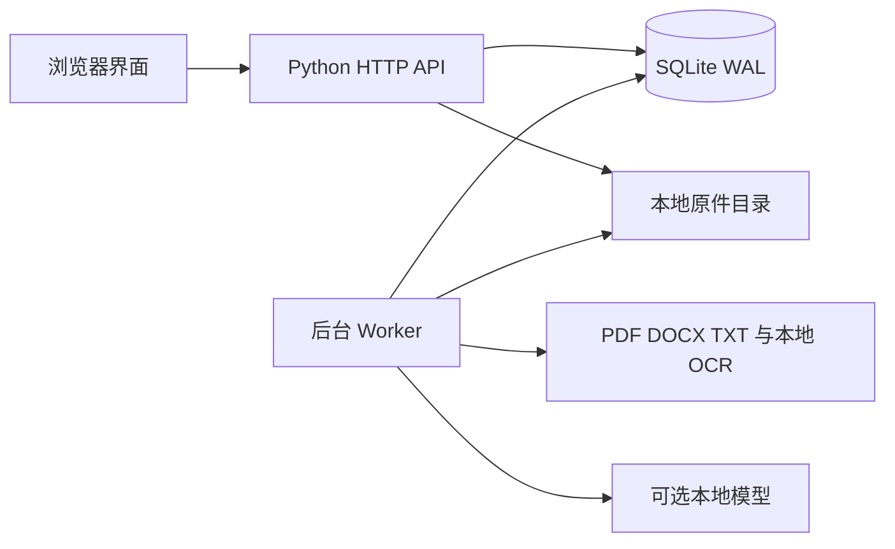

# 产品设计与数据规范

## 目标与范围

Talent Hub 用于集中保存 HR 手动获取的简历，形成可维护的人才档案，连接岗位跟进、面试记录和可复核匹配。它面向内部招聘协作，不提供公开招聘门户、招聘网站抓取、完整 Offer 审批或自动录用决定。

应用从空白工作区开始。统计和流程记录来自用户实际保存的数据，源码不附带候选人数据集。

## 架构

`server.py` 是命令行入口，HTTP 边界在 `talent_hub/http.py`，生命周期、配置和独占锁分别位于 `runtime.py`、`config.py`、`locking.py`；业务服务在 `service.py`，模型传输在 `model.py`，浏览器资产在 `web/`。公开静态资源使用白名单，附件必须通过鉴权接口读取。任务及其结果在数据库中保存，后台处理不依赖页面保持打开。同一工作区由操作系统锁保证只运行一个实例；绑定端口后才启动后台 Worker。

## 档案字段与质量

完整档案要求有效姓名、电话、邮箱、当前城市、目标城市、目标岗位、工作年限、教育经历和英语能力。在职时还要求当前公司和岗位；未任职通过明确状态表示。

技能、行业和薪资可以留空。月薪与年薪为独立的人民币税前范围，年薪表示年度总包；不自动换算。性别不作为结构化字段收集，不用于筛选、统计和匹配。原始简历可能自带相关内容，原件按附件权限管理。

字段完整与人工核实是不同状态。未知、待确认等占位值不算完整。解析字段保留原值、引文及页 / 行位置，人工修正与原文分别可追溯。

## 简历导入与重复

导入经历原件保存、解析、人工审查和建档几个阶段。任务独立记录状态、错误、尝试次数和人工决定。PDF 按页保留文本，DOCX / TXT 使用段落组及行定位；扫描件使用可选的本地 OCR。

文件哈希一致时复用已解析信息。电话和邮箱先标准化，姓名与公司组合用于提示；不对候选人的联系方式设置全局唯一约束。人工审查可选择关联既有人才、独立建档或跳过。关联只追加版本，明确采用新版本解析值后才更新主档，并要求重新核实。

## 岗位与面试

岗位可以拥有多个不可变 JD 版本。每个版本保存原文、条件、硬性或优先属性、权重和确认人。

人才库全局状态与岗位申请阶段独立。每个岗位申请记录责任人、下一步、期限和阶段历史。面试关联该申请，保存轮次、安排、面试官、反馈负责人及统一评价；不同岗位和不同轮次不会覆盖彼此。

## 匹配契约

匹配范围默认是完整且已人工核实的档案。任务创建时固定候选人修订、选定简历、JD、评分规则及模型配置。

条件逐项区分满足、部分满足、不满足和未知。缺少相关证据时显示待确认，不能仅凭未提及或列出其他技能判为不满足。模型引用必须存在于固定原文中；已核实年限和城市由程序再次复核。

证据分按已知条件的权重计算，覆盖度是已知条件权重占适用条件总权重的比例。覆盖度低于 70% 时显示信息不足及暂定分数。结果按硬性条件状态分组，再按覆盖度和证据分排序，不改变候选人的业务状态。

成功结果逐人保存，部分失败可以重试失败项。规则版本变化时创建新任务，避免用新规则静默改写历史结果。

## 权限、审计与数据修改

管理员、HR、招聘经理和面试官的范围由服务端校验。薪资、联系方式、正文、原件、导出和管理操作分别受角色限制。具体矩阵见[使用手册](USAGE.md)。

会话使用 HttpOnly / SameSite Cookie，修改请求校验来源和 CSRF Token。密码采用带独立盐的 scrypt 哈希。账号变更或改密会使相关会话失效。

业务记录具有修订号。修改时校验客户端读取的修订，冲突返回 409，避免覆盖他人保存的数据。重要查看、修改、下载、导出和管理操作记录登录操作者和时间。

## 统计口径

- 人才新增以首次建档时间计算，追加简历不计为新增人才。
- 运营筛选以候选人入库日期形成队列，岗位筛选取已加入该岗位的人才。
- 阶段转化分母是曾到达本阶段的岗位申请；只有真实访问过下一阶段才计为转化，跳阶段不作推定。
- 停留时间包含已结束区间和当前仍在进行的区间。
- 渠道面试率和录用率按去重人才计算。
- 导入解析率独立按上传日期和来源统计，尚未处理的任务不进入分母。

看板展示统计时点、筛选范围和定义，指标可下钻到对应人才。有权限的导出会留审计记录。
